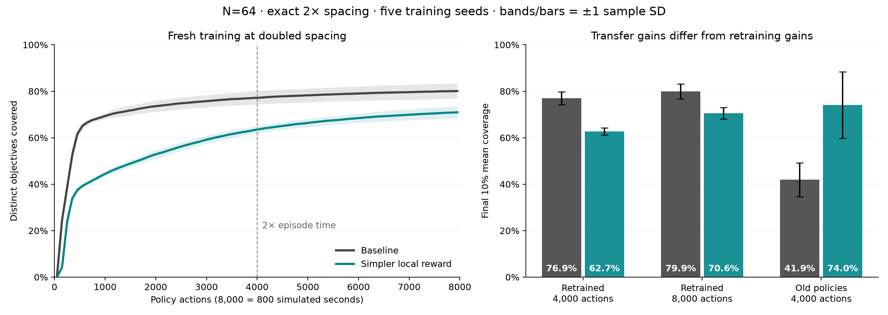
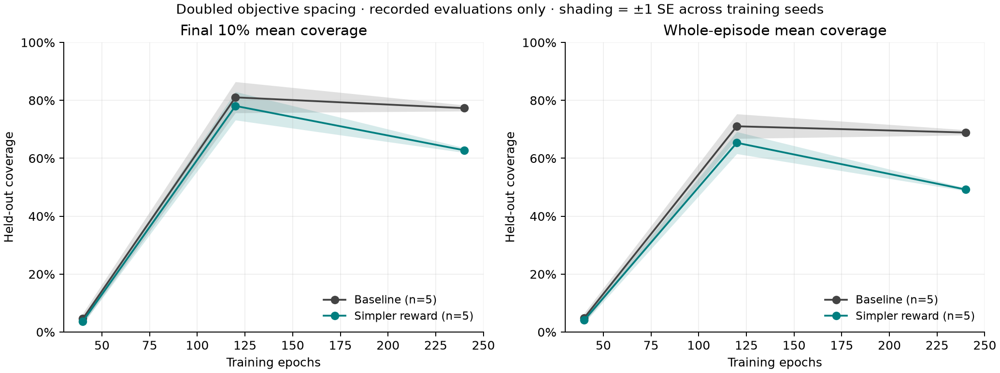

# Swarm navigator: doubled objective spacing at N=64

The earlier improvement **does not hold when retraining at doubled spacing** under the matched longer-budget protocol. At twice the original episode duration the baseline reaches **76.94%** final-window coverage and the simpler local reward reaches **62.72%**. Extending evaluation to four times the original duration narrows the gap, but the baseline still wins in all five paired training seeds (**79.94% versus 70.58%**).

This changes the earlier recommendation: retain the baseline as the safer tested choice across both densities. The one-kernel reward remains a promising experimental option at the original spacing, rather than a robust replacement. The paper's compact observations were already unsuccessful in the original comparison; this follow-up tests the strongest earlier reward candidate with the original 26 observations.



## Independent confirmation

Coverage counts each distinct objective once when an agent center is within that agent's radius. The primary score averages coverage over the final 10% of the episode: 400 actions for the 4,000-action test and 800 for the 8,000-action extension. Values below are mean ± sample SD across **five independent training seeds**, each evaluated on **64 fresh layouts**. The same layouts and stochastic action keys are used for both rewards. Intervals describe paired simpler-minus-baseline differences across training seeds, using a two-sided Student-t interval; the 64 episodes per model are not treated as 64 training seeds.

| Test at doubled spacing | Baseline | Simpler local reward | Paired difference [95% interval] |
| --- | ---: | ---: | ---: |
| Fresh training; 4,000 actions / 400 s | 76.94 ± 2.77% | 62.72 ± 1.56% | -14.22 pp [-18.61, -9.83] |
| Fresh training; 8,000 actions / 800 s | 79.94 ± 3.27% | 70.58 ± 2.49% | -9.36 pp [-15.19, -3.52] |
| Original policies, no retraining; 4,000 actions / 400 s | 41.89 ± 7.31% | 74.02 ± 14.29% | +32.12 pp [+17.77, +46.48] |

The first two rows evaluate the same final 240-epoch checkpoints. The extension performs no additional training. Both fresh-training comparisons favor the baseline in all five seeds, and both paired intervals exclude zero. No earlier checkpoint was selected to improve the candidate's final comparison.

The last row answers a different question: do policies trained at the original density transfer to the larger layout without updates? Here the simpler reward's old policies retain a substantial advantage, winning all five pairs. This is useful transfer evidence, but it cannot establish that the reward is easier or better to learn at the new spacing. Training first on the denser task could be a future curriculum experiment; this study did not test a subsequent sparse-layout fine-tuning stage.

## Geometry and extra time

Each seeded original layout is generated first and then every objective and initial agent coordinate is multiplied by two. Consequently **every pairwise objective distance doubles**, including the reset jitter. The reflective domain and its anchor also scale by two. This is more precise than resampling goals from a larger box. Objective-box width changes from 20 to 40, padding from 10 to 20, and total domain width from 30 to 60; area increases fourfold.

Agent radius remains 1, sensing range remains 16, and the reward kernel width remains 1.5 radii. Actions, drag, timestep (0.002 s), model, 26 observations, and PPO coefficients are held fixed, with the planned learning-rate schedule scaled to the longer training budget as shown below. The effective density and travel distances change, while sensor reach and capture radius do not. Both training rewards and policy observations remain local; exact global geometry is used only to score coverage.

| Budget | Original experiment | Doubled-spacing training | Extra evaluation |
| --- | ---: | ---: | ---: |
| Episode policy actions | 2,000 | 4,000 | 8,000 |
| Physics steps | 100,000 | 200,000 | 400,000 |
| Simulated duration | 200 s | 400 s | 800 s |
| Training epochs | 120 | 240 | Same 240-epoch checkpoints |
| Planned LR schedule | 2,160 epochs | 4,320 epochs | No updates |
| Agent decisions per trained model | 24,576,000 | 49,152,000 | No updates |

Doubling training epochs as well as episode time preserves six episode cycles per environment. Doubling the planned learning-rate schedule preserves its relative progress after those cycles. There are 32 parallel training environments and 100 actions per epoch, with 50 physics steps per action. The extra 8,000-action evaluation uses a genuinely longer environment time limit: all 64 environments reach step 400,000, and no truncation occurs at the old 200,000-step boundary.

The extension helps the simpler policy more: its mean endpoint coverage rises from **63.50% at action 4,000 to 71.01% at action 8,000** (+7.51 percentage points), while the baseline rises from **77.21% to 80.21%** (+3.00 points). Nevertheless, the baseline remains ahead. Both curves still improve slowly near the end, so this is evidence for the tested finite horizons, not a claim about infinite-time convergence.

## Learning behavior and interpretation

The separate 32-layout screening set shows deterioration between epochs 120 and 240, particularly for the simpler reward. Its five-seed final-window mean falls from 78.09% to 62.76%; the baseline changes from 81.04% to 77.31%. Intermediate checkpoints are saved for diagnosis, but the main result uses the preselected final epoch. Screening layouts are distinct from the 64-layout confirmation set.



The simpler score uses one local rational kernel, `K(d)=1/(1+(d/(1.5*radius))**2)`, divided by local peer claims; reward is the score difference across a policy action. It was inspired by local vacancy exploration in [Sun et al. (2023)](https://www.nature.com/articles/s41467-023-39251-5), rather than reproducing the paper's controller. A possible explanation for its spacing sensitivity is that this kernel's far-field gradient decays approximately as inverse distance cubed, weakening its approach signal at larger distances. The baseline retains a separate approach term. This explanation is a hypothesis: sensing, sharing, recurrent control, and PPO learning dynamics also change with density, and the learning regression has not been causally isolated.

The experiment does not establish that every simpler reward or every observation reduction fails. It establishes that the earlier best tested simplification does not reliably beat the baseline when learned directly at this doubled spacing and these budgets. No production environment or source experiment script was changed.

## Validation and artifacts

- GPU training and evaluation used CUDA on the RTX 5070 Ti Laptop GPU.
- All 10 training runs completed 240 epochs: 2,400 contiguous finite training epochs, with no detected collider overflow.
- All 30 screening, 10 fresh confirmation, 10 extended confirmation, and 10 zero-shot archives were checked. Extended trajectories match their corresponding 4,000-action prefixes bit for bit for all five saved per-action metrics.
- Paired initial training layouts match for all five seeds. Confirmation uses reset seed 50000 and action seed 60000, distinct from screening seeds 10000/20000. All three confirmation conditions use the same 64 enlarged layouts.
- Twelve focused geometry/reward/reset tests and a one-epoch CPU smoke run of each variant passed before GPU training. Objective-coordinate error from exact 2× scaling is at most 4.77e-7; pairwise-distance error is at most 3.82e-6. Agent starts are bitwise exactly doubled.
- The original radial-tanh action mapping is frozen and hash-checked against the previous comparison. Concurrent changes to the shared checkout's action mapping were preserved. These results apply to that original mapping.

See the [protocol](protocol.json), [geometry/test audit](qa/geometry_and_tests.json), [final audit](qa/final_spacing_audit.json), [zero-shot audit](qa/zero_shot_audit.json), [runtime manifest](runtime_manifest.json), and [module hashes](new_module_hashes.json). Summaries: [fresh 4,000 actions](confirmation/summary_spacing.csv), [extended 8,000 actions](extended_confirmation/summary_spacing.csv), [zero-shot](zero_shot/summary_spacing.csv), and [training screen](summary_spacing.csv). Each training run retains configuration, source hashes, full trainer/model/optimizer checkpoints, per-epoch training logs, and per-action evaluation arrays; evaluation-only directories reference their source checkpoints. This report and figure can be regenerated with `python report_generation.py` after running the spacing summarizer on each result collection.

## Reproduction

Run training/evaluation from this folder's frozen `runtime` directory, using a new output directory. The helper defaults implement the geometry and budgets above; `--checkpoint-at-120` also retains intermediate checkpoints.

```bash
JAX_PLATFORMS=cuda JAX_ENABLE_X64=0 XLA_PYTHON_CLIENT_PREALLOCATE=false \
  python -m benchmarks.swarm_mean_shift.spacing_followup \
  --variants spacing_baseline spacing_rational_delta --seeds 0 1 2 3 4 \
  --checkpoint-at-120 --output /tmp/swarm_spacing_2x

JAX_PLATFORMS=cuda JAX_ENABLE_X64=0 XLA_PYTHON_CLIENT_PREALLOCATE=false \
  python -m benchmarks.swarm_mean_shift.spacing_evaluate \
  --runtime-root "$PWD" --input /tmp/swarm_spacing_2x \
  --output /tmp/swarm_spacing_2x/confirmation

JAX_PLATFORMS=cuda JAX_ENABLE_X64=0 XLA_PYTHON_CLIENT_PREALLOCATE=false \
  python -m benchmarks.swarm_mean_shift.spacing_long_evaluate \
  --runtime-root "$PWD" --input /tmp/swarm_spacing_2x \
  --output /tmp/swarm_spacing_2x/extended_confirmation
```

Run `benchmarks.swarm_mean_shift.spacing_summarize --input <collection>` from the repository root to regenerate the summaries and individual figures. The separate `spacing_zero_shot` helper restores the original 120-epoch checkpoints before changing evaluation geometry and duration. This preserves the distinction between new training and transfer.
